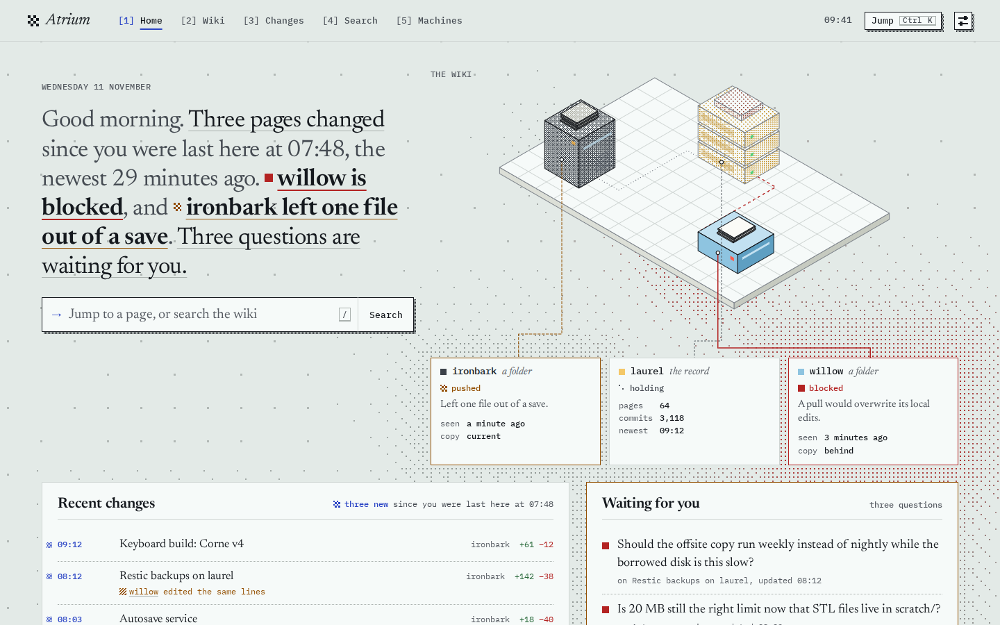
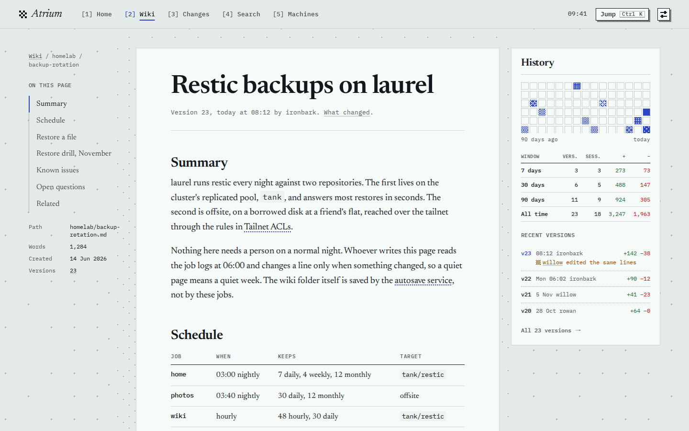
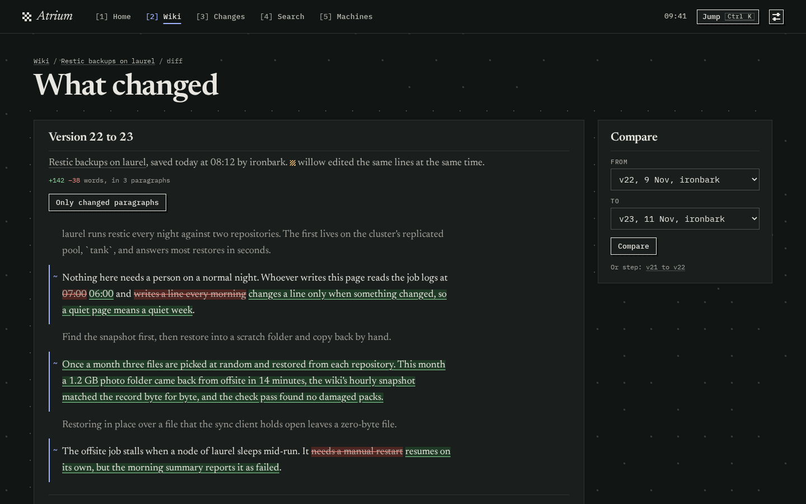
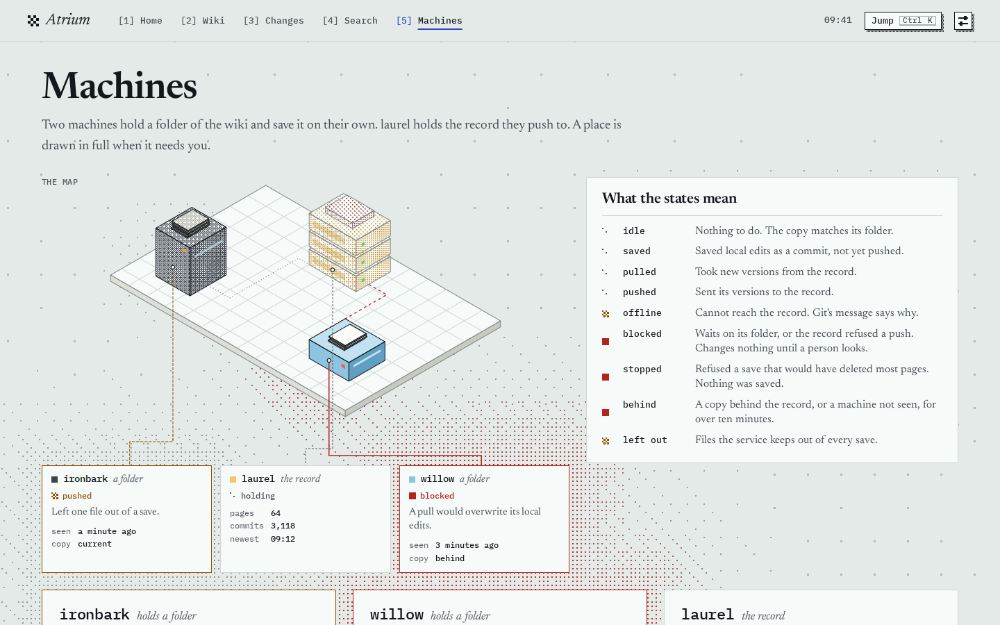

# Atrium

Atrium is a private homepage and dashboard for one person. Its first feature reads a wiki of Markdown files that [Mneme](https://github.com/notes-supply/mneme) keeps in Git: the pages, their history and diffs, recent changes, search, and the machines that write to the wiki. It reads a wiki folder on your own machine, or a Mneme server. Pages are HTML that works without scripts; Rust Wasm modules add the field of dots behind them, a command palette, keys, live search and link previews.

<picture>
  <source media="(prefers-color-scheme: dark)" srcset="docs/images/home-dark.png">
  <source media="(prefers-color-scheme: light)" srcset="docs/images/home-light.png">
  
</picture>

## Install

Mneme's installer installs the latest `mneme` and `atrium` into `~/.local/bin`, on Linux on x86_64 or aarch64:

```sh
curl -fsSL https://raw.githubusercontent.com/notes-supply/mneme/main/install.sh | sh
```

It checks each binary against its release's `SHA256SUMS`, and against its signature when `cosign` is on `PATH`. It also puts Atrium's systemd user unit, [`contrib/atrium.service`](contrib/atrium.service), in `~/.config/systemd/user`, without enabling it. To check a download yourself, see [Verify a download](#verify-a-download).

## Run it on your machine

`mneme init` makes `~/wiki` a clone of the wiki and keeps it saved and in sync. The wiki lives on a Mneme server, on a Git host over HTTPS with a token, or in a repository on this machine:

```sh
mneme init --server https://mneme.example --token-file ~/.config/mneme/token
mneme init --remote https://github.com/someone/wiki.git --token-file ~/.config/mneme/token
mneme init --remote ~/wiki.git
```

[Mneme's README](https://github.com/notes-supply/mneme) says more about each. Then serve the folder:

```sh
atrium --wiki-folder ~/wiki
```

or keep it running with the unit the installer put in place, whose logs are in `journalctl --user -u atrium`:

```sh
systemctl --user enable --now atrium
```

and open http://localhost:8080. Atrium starts `mneme serve --folder ~/wiki` itself and stops it when it stops, and a new commit shows within seconds. Every page shows the whole wiki and there is no login, so with `--wiki-folder` Atrium listens on loopback only, `127.0.0.1:8080` by default, and refuses any other `--addr`.

`atrium --demo --viewer owner` serves the invented wiki in these screenshots, with no Mneme.

## Share it on a tailnet

`tailscale serve` on the same machine keeps Atrium on loopback and adds HTTPS. Allow the name it is reached by:

```sh
tailscale serve --bg 8080
atrium --wiki-folder ~/wiki --allowed-hosts localhost,<machine>.<tailnet>.ts.net
```

Then open `https://<machine>.<tailnet>.ts.net`. For the unit, uncomment its `Environment=ATRIUM_ALLOWED_HOSTS=` line with that name, then run `systemctl --user daemon-reload` and `systemctl --user restart atrium`. Everyone your tailnet lets reach this machine can then read the whole wiki, so check its access rules first. Never use `tailscale funnel` for it: that would put the wiki on the public internet.

## Run it on a server

For several writers, [`examples/server`](examples/server) runs Mneme and Atrium together on one small always-on machine with podman or docker compose, and puts them on a tailnet the same way. [docs/deploy.md](docs/deploy.md) describes the image, the releases and a cluster running Flux.

## Configuration

Every flag can also be set in the environment:

| Flag | Environment | Meaning |
| --- | --- | --- |
| `--addr` | `ATRIUM_ADDR` | Where to listen. `127.0.0.1:8080` by default; the image sets `0.0.0.0:8080`. |
| `--viewer` | `ATRIUM_VIEWER` | Who reaches this listener: `owner`, the person this Atrium belongs to, sees private features, and `anonymous` only public ones. `tailnet` is another name for `owner`. Required, but `owner` by default with `--wiki-folder`. |
| `--allowed-hosts` | `ATRIUM_ALLOWED_HOSTS` | Host names requests may name, comma-separated, each with any port. `localhost,127.0.0.1,[::1]` by default. `/healthz` answers any. |
| `--mneme-url` | `ATRIUM_MNEME_URL` | Mneme's base URL. Required without `--wiki-folder` or `--demo`. |
| `--wiki-folder` | `ATRIUM_WIKI_FOLDER` | A wiki folder on this machine, read through a `mneme serve --folder` that Atrium starts. Needs a loopback `--addr`, and makes `owner` the default viewer. |
| `--mneme-bin` | `ATRIUM_MNEME_BIN` | The Mneme that `--wiki-folder` starts. `mneme` on `PATH` by default. |
| `--record-name` | `ATRIUM_RECORD_NAME` | What the footer, the map and the machines page call the place that holds the wiki's record. The host of `--mneme-url` by default, this machine's short host name with `--wiki-folder`, and `laurel` in the demo. |
| `--mneme-timeout-ms` | `ATRIUM_MNEME_TIMEOUT_MS` | How long one call to Mneme may take. 3000 by default. Home waits at most 500 ms. |
| `--time-zone` | `ATRIUM_TIME_ZONE` | The reader's time zone, for every time shown and the light of the hour. The system's by default, from `TZ` or `/etc/localtime`, or UTC when it names none. The demo's is `Europe/Stockholm`. |
| `--demo` | | Serve the invented wiki instead of a Mneme, `--mneme-url` not needed. |

Logs are JSON lines on standard error, one per request, with the lines of the Mneme that `--wiki-folder` starts among them. Atrium stops with an error when that Mneme does, so that a supervisor starts both again. SIGTERM stops it after the requests in flight.

## More screenshots

A page, with its contents and its history beside it:



What changed between two versions, paragraph by paragraph, at night:



The machines that hold the wiki, and what their states mean:



## Verify a download

Each release has a static `atrium` for Linux on x86_64 and aarch64, `SHA256SUMS`, and a cosign bundle per binary, signed keyless by `.github/workflows/binaries.yml` on the release's tag. To check one with [cosign](https://docs.sigstore.dev/cosign/system_config/installation/), with `vX.Y.Z` the release you want:

```sh
arch=$(uname -m)
base=https://github.com/notes-supply/atrium/releases/download/vX.Y.Z
curl -fL -O "$base/atrium-$arch-linux" -O "$base/atrium-$arch-linux.sigstore.json"
cosign verify-blob --bundle "atrium-$arch-linux.sigstore.json" \
  --certificate-oidc-issuer https://token.actions.githubusercontent.com \
  --certificate-identity https://github.com/notes-supply/atrium/.github/workflows/binaries.yml@refs/tags/vX.Y.Z \
  "atrium-$arch-linux"
install -D -m 755 "atrium-$arch-linux" ~/.local/bin/atrium
```

## Develop

[docs/development.md](docs/development.md) says how to build and run Atrium from a checkout, how it is put together, and how the gate and the browser tests check it. [docs/decisions.md](docs/decisions.md) records the choices that were not obvious.

## License

Atrium is licensed under either of the [Apache License, Version 2.0](LICENSE-APACHE) or the [MIT license](LICENSE-MIT), at your option.

Unless you explicitly state otherwise, any contribution intentionally submitted for inclusion in Atrium by you, as defined in the Apache-2.0 license, shall be dual licensed as above, without any additional terms or conditions.
