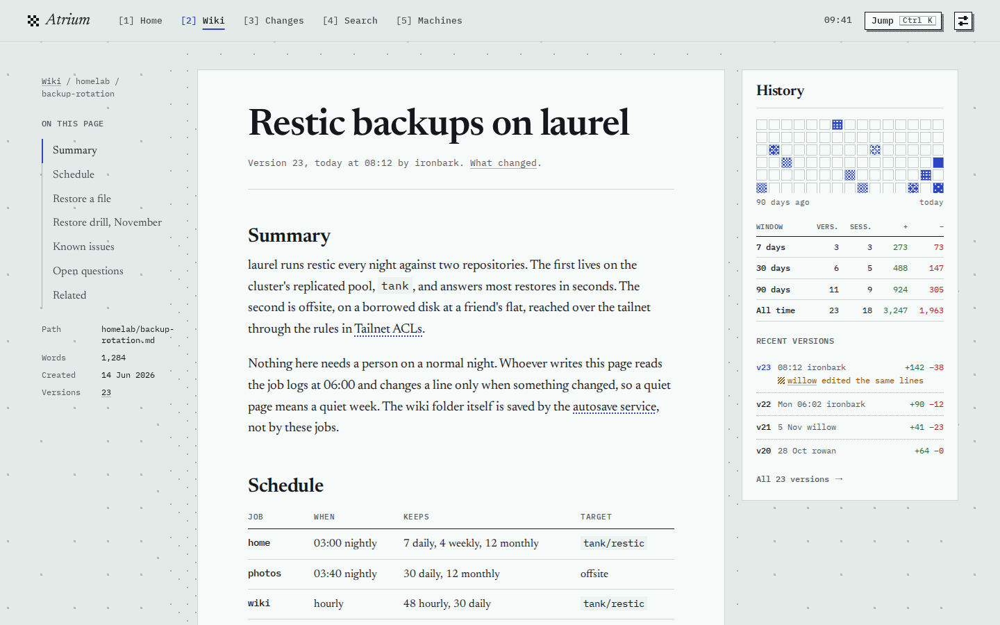
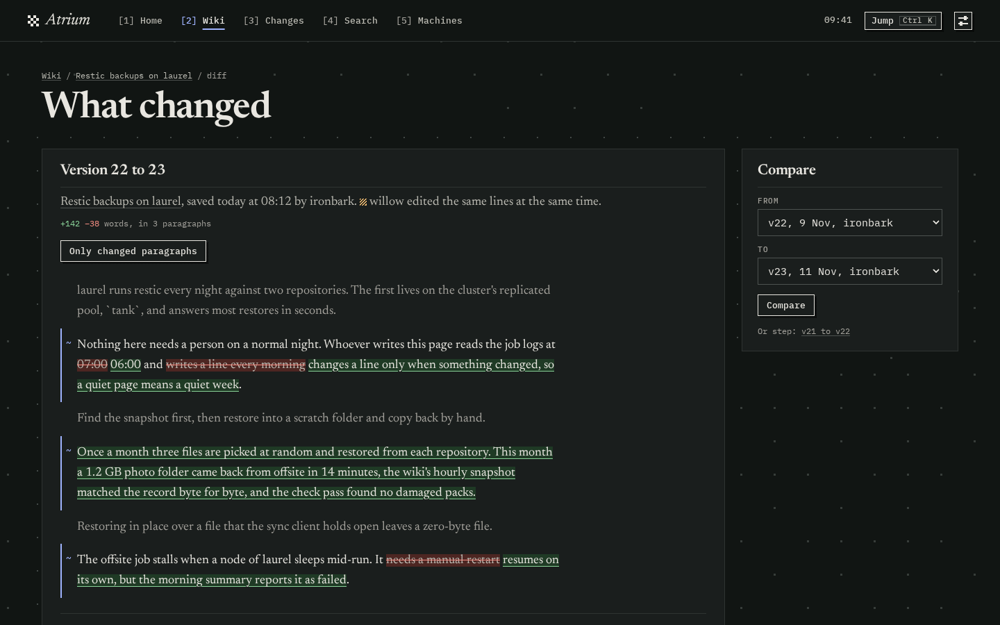
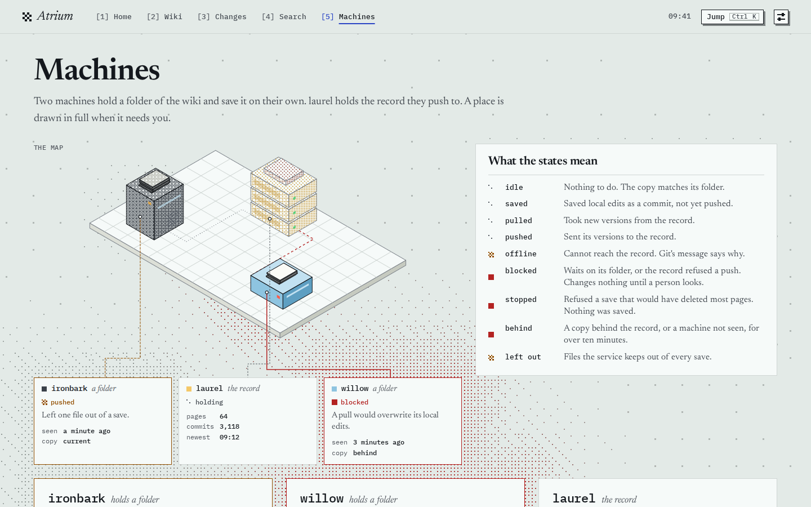
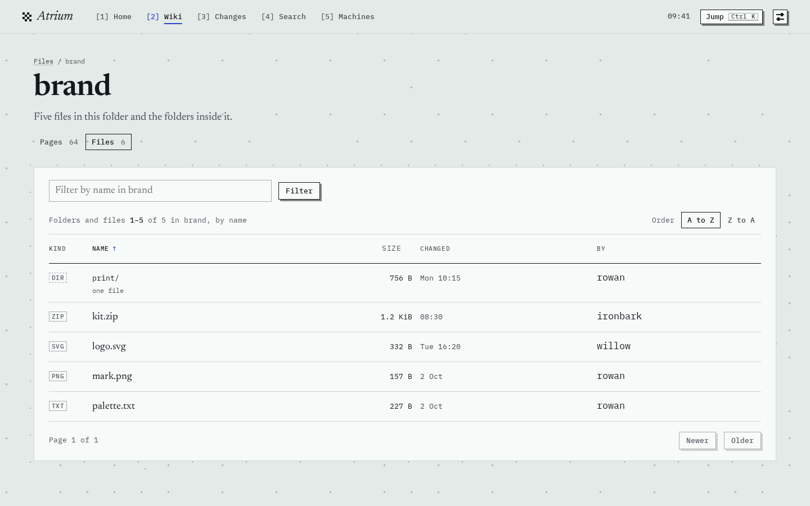
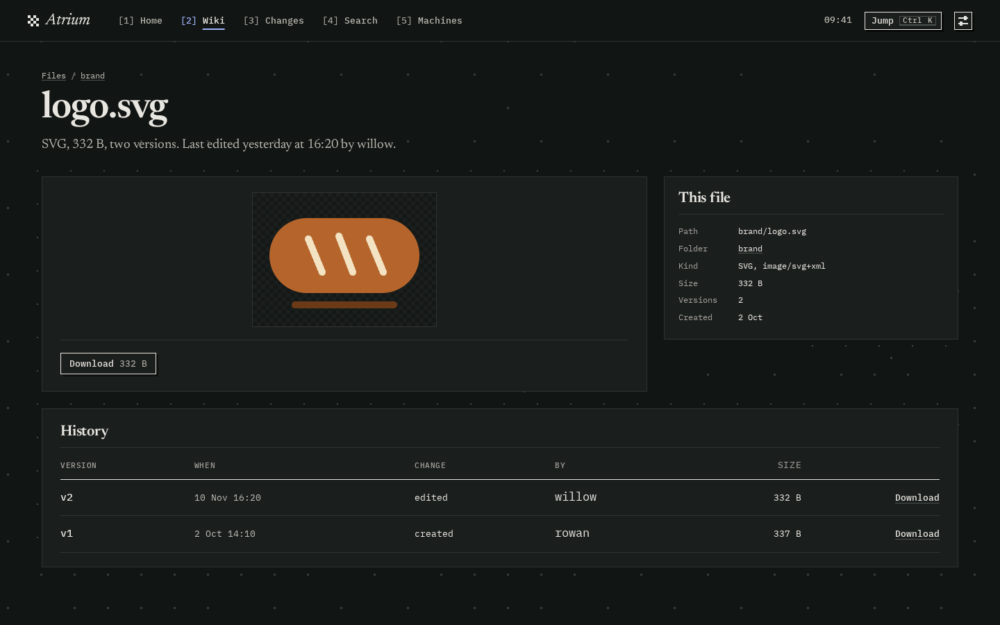
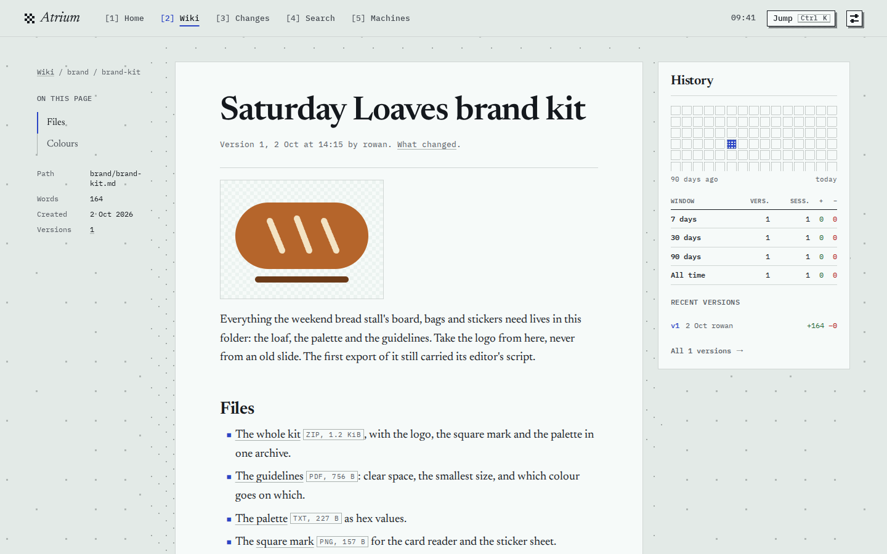

# Screenshots

Atrium serving `--demo`, its invented wiki. `mise run screenshots` makes them again ([development.md](development.md)).

A page, with its contents and its history beside it:

What changed between two versions, paragraph by paragraph, at night:

The machines that write to the wiki, and what their states mean:

The files in a folder, its folders first, with the kind, size and last change of each:

A file's page, at night: the image, its download, what the record says of it, and every version with a download of each:

A page that shows an image from its folder and links the files beside it, each marked with its kind and size:

Recent changes on home list a file among the pages: kit.zip, changed at 08:30, in the screenshot at the top of the README.
