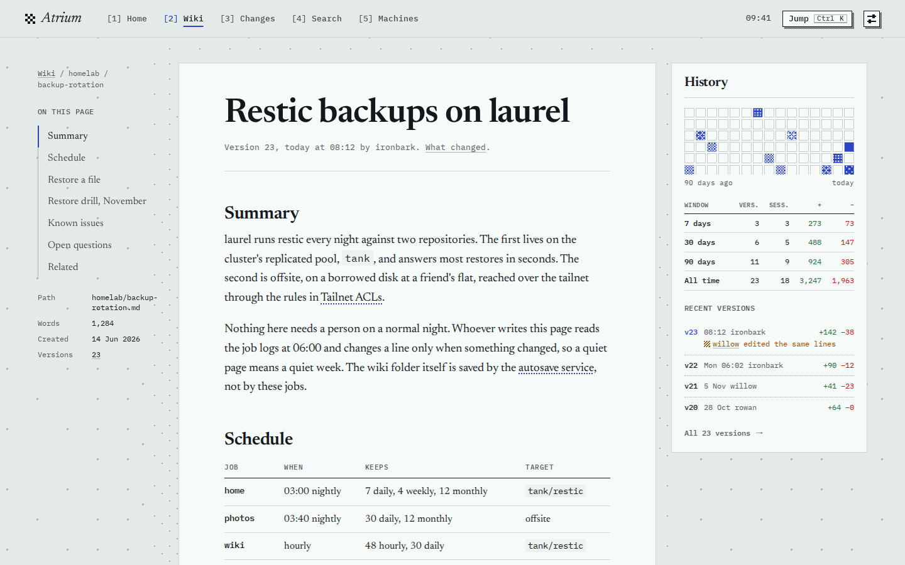
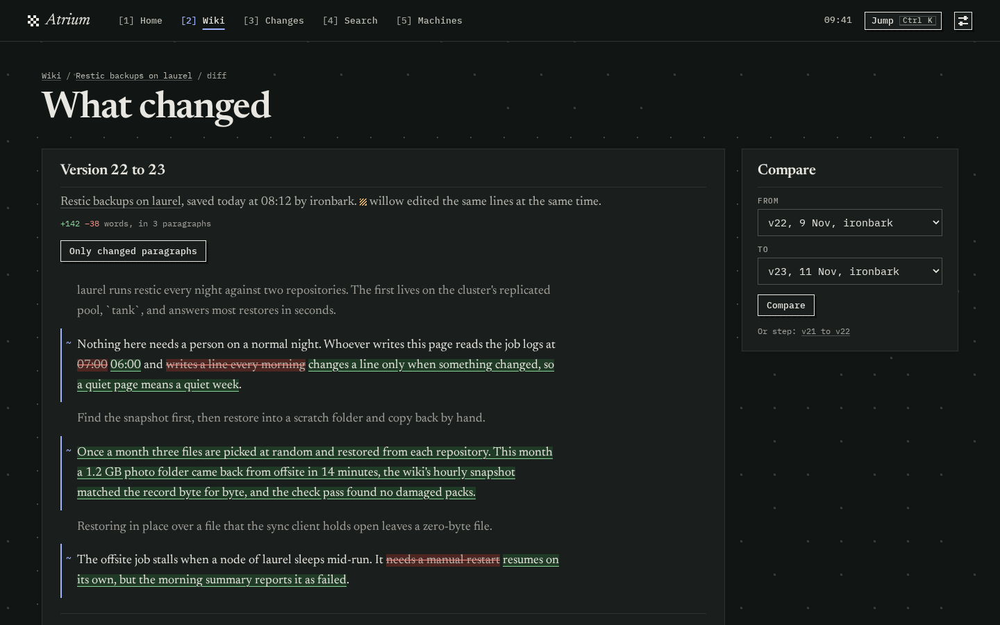
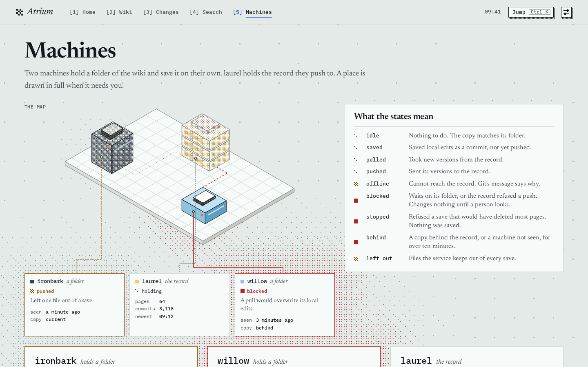

# Screenshots

Atrium serving `--demo`, its invented wiki. `mise run screenshots` makes them again ([development.md](development.md)).

A page, with its contents and its history beside it:

What changed between two versions, paragraph by paragraph, at night:

The machines that write to the wiki, and what their states mean:

